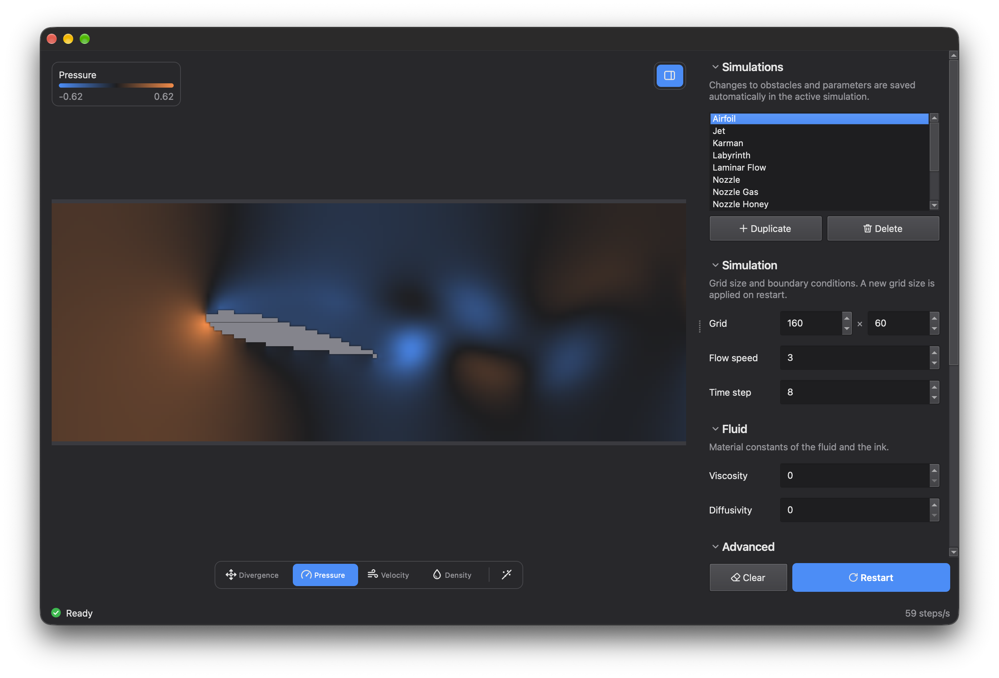
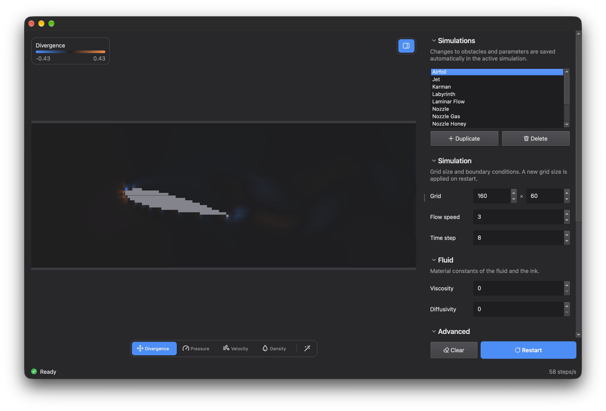
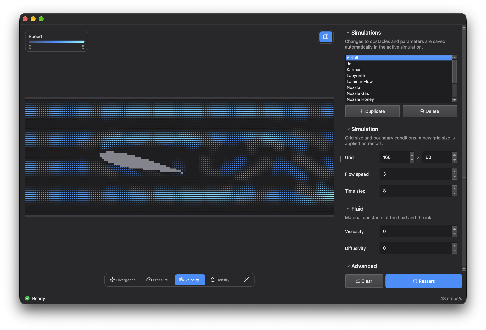
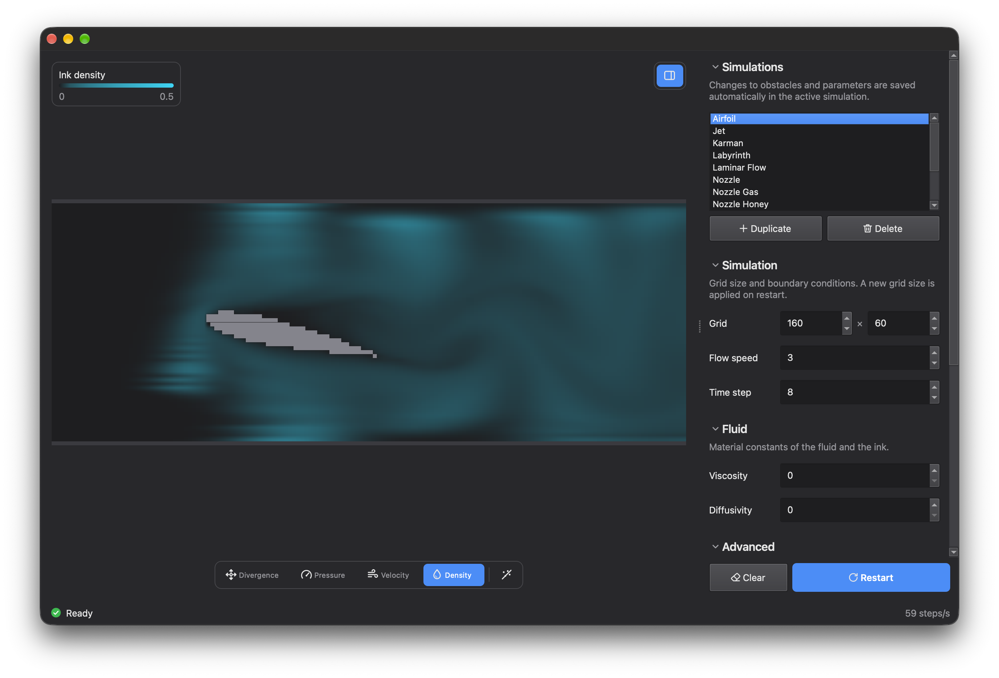

<div align="center">

# Real-Time Fluid

Draw obstacles into a channel and watch the flow around them change in real time. A 2D fluid simulation with a dark Qt 6 interface for macOS, Windows and Linux.

<p>
  
  
  
  
  
  
</p>

<p>
  <a href="https://github.com/Foxei/sdi-flow-control/actions/workflows/release.yml"></a>
</p>

<p>
  <a href="#features-at-a-glance">Features</a> •
  <a href="#fields">Fields</a> •
  <a href="#using-the-application">Usage</a> •
  <a href="#download">Download</a> •
  <a href="#getting-started">Getting started</a> •
  <a href="#development">Development</a> •
  <a href="#background">Background</a> •
  <a href="#license">License</a>
</p>

</div>

<p align="center">
  
</p>

Real-Time Fluid simulates an incompressible 2D flow through a channel while you interact with it. Draw obstacles, release particles, add ink and push the fluid with the mouse, and watch the velocity, pressure, divergence or ink density react live.

The solver implements "Stable Fluids" by Jos Stam: diffusion, projection and semi-Lagrangian convection, with the linear systems solved by Gauss-Seidel iterations. It is a plain C++ library without Qt and runs in its own thread, so the interface stays responsive while it computes.

## Features at a glance

| Area | What you get |
| --- | --- |
| [Live simulation](#fields) | Divergence, pressure, velocity and ink density, switchable at any time with the keys <kbd>1</kbd> to <kbd>4</kbd> |
| [Mouse interaction](#mouse) | Draw and erase obstacles, release particles with or without traces, add ink, push the fluid |
| [Example simulations](#example-simulations) | Vortex street, airfoil, tube bank, jet, labyrinth and more, ready to explore |
| [Stored simulations](#using-the-application) | Every change is saved automatically, duplicate a simulation to experiment with a copy |
| [Consistent interface](#fields) | The same dark interface with the system font and sharp SVG icons on every platform and screen density |
| [Prebuilt apps](#download) | Universal macOS app, Windows zip and Linux AppImages for x86_64 and ARM64 attached to every release |
| [Containerized builds](#option-1-docker-compose) | Native apps for macOS, Windows and Linux from one `docker compose up`, nothing else installed on the host |

## Fields

<table>
  <tr>
    <td align="center"><br /><strong>Divergence</strong> <kbd>1</kbd></td>
    <td align="center"><br /><strong>Pressure</strong> <kbd>2</kbd></td>
  </tr>
  <tr>
    <td align="center"><br /><strong>Velocity</strong> <kbd>3</kbd></td>
    <td align="center"><br /><strong>Density</strong> <kbd>4</kbd></td>
  </tr>
</table>

All four views show the Airfoil example: a wing at 12° angle of attack that stalls while a large vortex separates from its top.

## Using the application

Pick a stored simulation in the sidebar, or change the parameters of the running one. All changes are saved automatically in the active simulation; **Duplicate** keeps a copy to experiment with. A new grid size is applied with **Restart** (<kbd>Ctrl</kbd>+<kbd>R</kbd>, <kbd>Cmd</kbd>+<kbd>R</kbd> on macOS). The field shown is selected below the simulation.

### Mouse

| Mouse | Action |
| --- | --- |
| Left drag | Release particles |
| Right drag | Release particles that leave a trace; in the density view, add ink |
| <kbd>Shift</kbd> + left drag | Draw obstacles |
| <kbd>Shift</kbd> + right drag | Erase obstacles |
| <kbd>Ctrl</kbd> + drag (<kbd>Cmd</kbd> on macOS) | Push the fluid in the drag direction |

### Example simulations

| Example | What to look at |
| --- | --- |
| Vortex Street | A cylinder sheds alternating vortices (Kármán vortex street), best in the pressure view |
| Airfoil | A wing at 12° angle of attack stalls, a large vortex separates from its top |
| Tube Bank | Flow through a staggered array of tubes, like in a heat exchanger |
| Jet | A jet through a narrow slot rolls up into vortices on both sides |
| Labyrinth | The flow snakes between baffles, with recirculation in every chamber |
| RWTH | Lettering as obstacles |
| Karman, Laminar Flow, Nozzle, Nozzle Gas, Nozzle Honey | The original examples from 2017 |

The simulations are stored per user. Delete `simulations.json` there to get the original presets back.

| OS | Location |
| --- | --- |
| macOS | `~/Library/Application Support/RWTH SDI/RealTimeFluid` |
| Windows | `%APPDATA%\RWTH SDI\RealTimeFluid` |
| Linux | `~/.local/share/RWTH SDI/RealTimeFluid` |

## Download

Prebuilt apps are attached to every [GitHub release](https://github.com/Foxei/sdi-flow-control/releases):

| OS | File |
| --- | --- |
| macOS 13+ (Apple Silicon and Intel) | `RealTimeFluid-macos-universal.zip` |
| Windows 10+ (x86_64) | `RealTimeFluid-windows-x86_64.zip` |
| Linux (x86_64 / ARM64) | `RealTimeFluid-linux-x86_64.AppImage`, `RealTimeFluid-linux-aarch64.AppImage` |

> [!NOTE]
> The macOS app is not notarized. On first launch, right-click it and choose **Open**, or run `xattr -dr com.apple.quarantine RealTimeFluid.app`.

## Getting started

### Option 1: Docker Compose

All you need is [Docker](https://docs.docker.com/get-docker/). A single command builds a self-contained application for your operating system and writes it to `dist/`:

| Your OS | Command | Toolchain | Result |
| --- | --- | --- | --- |
| macOS | `docker compose up macos` | clang/lld and the official Qt frameworks | `dist/macos/RealTimeFluid.app`, universal arm64 and x86_64, macOS 13+ |
| Windows | `docker compose up windows` | [llvm-mingw](https://github.com/mstorsjo/llvm-mingw) and the official Qt for Windows | `dist/windows/RealTimeFluid/RealTimeFluid.exe`, x86_64, Windows 10+ |
| Linux | `docker compose up linux` | GCC on Ubuntu 24.04 and [linuxdeploy](https://github.com/linuxdeploy/linuxdeploy) | `dist/linux/RealTimeFluid-<arch>.AppImage` |

`docker compose up` without a service name builds Linux and Windows. The first build downloads the toolchains and Qt and takes a few minutes; later builds are cached.

The Linux AppImage is built for the architecture of the machine running Docker and needs glibc 2.39 or newer (Ubuntu 24.04, Debian 13, Fedora 40 or later):

```bash
chmod +x dist/linux/RealTimeFluid-*.AppImage
./dist/linux/RealTimeFluid-*.AppImage
```

The macOS build needs the macOS SDK from the host, see [macOS SDK](#configuration).

### Option 2: Native macOS build without Docker

You need only Python 3 and the Xcode Command Line Tools. The script installs Qt, Eigen, CMake and Ninja into `build-macos/`:

```bash
packaging/build-macos-native.sh   # dist/macos/RealTimeFluid.app
```

### Option 3: Native build with CMake

Requirements: Qt 6.8 or newer (Core, Gui, Widgets, Svg), Eigen 3.4, CMake 3.16 or newer and a C++17 compiler.

```bash
cmake -S code -B build -DCMAKE_BUILD_TYPE=Release
cmake --build build -j
./build/src/app/RealTimeFluid          # Linux/Windows
open build/src/app/RealTimeFluid.app   # macOS
```

If CMake can't find Qt or Eigen, pass their locations, for example `-DCMAKE_PREFIX_PATH=$(brew --prefix qt)` or `-DCMAKE_PREFIX_PATH=~/Qt/6.10.1/macos`. An Eigen source tree without CMake config can be used with `-DEIGEN3_INCLUDE_DIR=<path>`.

## Development

### VS Code Dev Container

The repository includes a Dev Container with GCC, CMake, Ninja, GDB, Doxygen, Eigen and Qt 6.10. All Docker builds start from the same image.

1. Open the repository in VS Code.
2. Run `Dev Containers: Reopen in Container`.
3. CMake Tools is already configured to use `code/` as the source directory.

The Dev Container is meant for editing and building. To run the GUI, build a native app with `docker compose up <os>`.

### Icons

All icons are SVGs in `code/res/icons/`, so they stay sharp on Retina and other high-DPI screens. The platform app icons in `code/res/app/` (`.icns` for macOS, `.ico` for Windows, `.png` for Linux) are generated from `app.svg`. After changing it, regenerate them with:

```bash
docker run --rm -v "$PWD:/w" -w /w debian:trixie-slim packaging/generate-icons.sh
```

### API documentation

```bash
cd code && doxygen Doxyfile   # output in code/doxygen/
```

### Releases

[`.github/workflows/release.yml`](.github/workflows/release.yml) builds all platforms when a GitHub release is published and attaches the files to it. Linux and Windows use the same Docker Compose services as above; macOS is built natively on a macOS runner with `packaging/build-macos-native.sh`, because GitHub's macOS runners have no Docker. To test the builds without creating a release, run the workflow manually from the Actions tab; the files then appear as workflow artifacts.

## Configuration

<details>
<summary><strong>macOS SDK for the Docker build</strong></summary>

Apple does not allow the macOS SDK to be redistributed, so the macOS build takes it from the host as a Docker build context. By default it uses the SDK of the Xcode Command Line Tools, which you install once with:

```bash
xcode-select --install
```

To use a different SDK, set `MACOS_SDK`:

```bash
MACOS_SDK=/Applications/Xcode.app/Contents/Developer/Platforms/MacOSX.platform/Developer/SDKs/MacOSX.sdk docker compose up macos
```

That's why the macOS build only works on a Mac. The Linux and Windows builds do not need the SDK.

</details>

<details>
<summary><strong>Gatekeeper and ad-hoc signing on macOS</strong></summary>

The app is ad-hoc signed. A locally built copy opens normally. If you copy it to another Mac (for example via AirDrop or a download), Gatekeeper blocks it. In that case, remove the quarantine flag:

```bash
xattr -dr com.apple.quarantine RealTimeFluid.app
```

</details>

## Stack

| Layer | Technologies |
| --- | --- |
| Solver | C++17 and Eigen 3.4, no Qt, Stable Fluids with Gauss-Seidel iterations |
| Application | Qt 6 Widgets and Svg, model / view / controller, solver in a worker thread |
| Build | CMake 3.16+, Ninja |
| Toolchains | GCC and linuxdeploy on Linux, llvm-mingw for Windows, clang/lld for macOS |
| Operations | Docker Compose, VS Code Dev Container, GitHub Actions with release publishing |

## Repository layout

```text
sdi-flow-control/
├── code/
│   ├── src/solver/          # Fluid solver library (C++17 + Eigen, no Qt)
│   ├── src/app/             # Qt GUI (model / view / controller, solver in a worker thread)
│   ├── res/icons/           # SVG icons (UI and app icon)
│   ├── res/app/             # Platform app icons, Info.plist, Windows resource file
│   └── res/presets/         # Simulations shipped with the app
├── doc/                     # Original documentation, presentations and UML diagrams (2017)
├── doc/images/              # Screenshots
├── packaging/               # Cross-compilation toolchains, build and deployment scripts
├── .devcontainer/           # VS Code Dev Container
├── .github/workflows/       # Release builds
├── Dockerfile               # Build stages for the Dev Container and all platforms
└── docker-compose.yml       # Builds native apps into dist/
```

## Background

This project was written during the software development internship (Softwareentwicklungspraktikum) of the Bachelor in Computational Engineering Science at RWTH Aachen University in summer semester 2017. Students work in small groups on a software project for one of the university's institutes, learning the Qt framework, teamwork, maintainability and documentation. This application was the main institute project. The original documentation (in German) is in [`doc/tex/documentation.pdf`](doc/tex/documentation.pdf).

Authors:

- Simon Schäfer
- Markus Klaus Mizael Moser
- Sören Mehnert
- Sharon Michael Rouf-Chowdhury

## License

This project is licensed under the [GNU General Public License v3.0](LICENSE).
